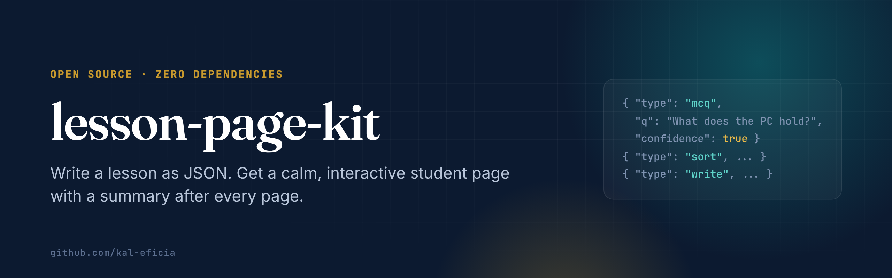
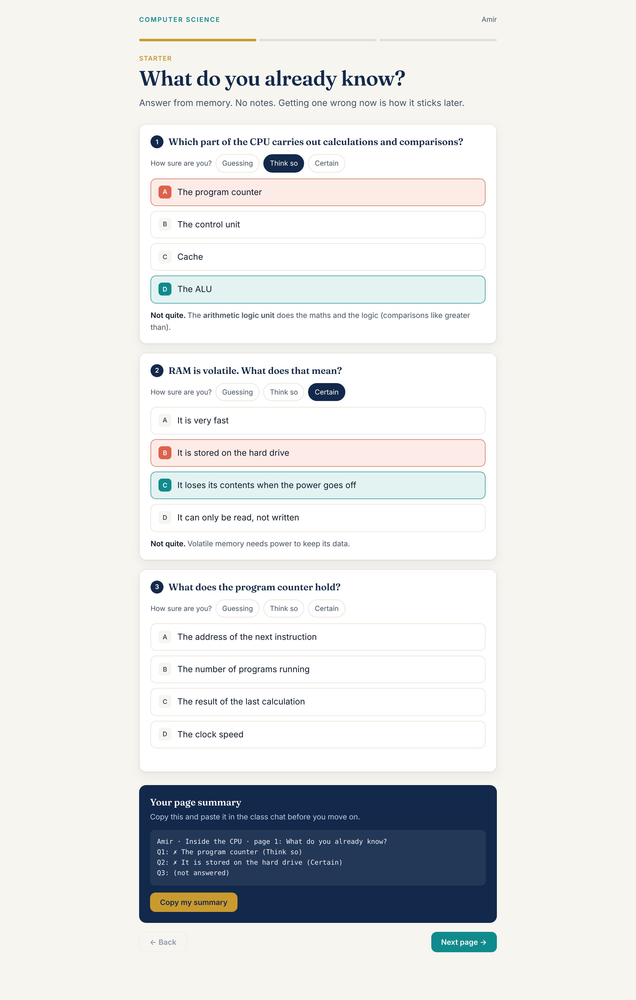
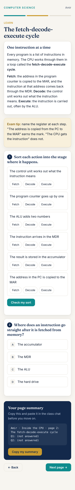

<p align="center"></p>

<p align="center">
  <a href="https://kal-eficia.github.io/lesson-page-kit/"></a>
  
  
  
</p>

Write a lesson as JSON. Get a calm, multi-page student page that works on any phone or laptop, with no logins, no accounts and no build step.

**[Try the demo lesson →](https://kal-eficia.github.io/lesson-page-kit/)**

<p align="center">
  
  &nbsp;
  
</p>

## Why

I teach remote lessons to 11 to 18 year olds. The page students work on matters more than any slide deck, and most tools get the details wrong. This kit gets them right:

- **A summary after every page.** Students copy it into the class chat page by page, so the teacher sees the work as it happens, not at the end.
- **Confidence checks.** "Guessing / Think so / Certain" on any question. A confident wrong answer is the most useful thing a teacher can see.
- **No self-marking.** Multiple choice and sort tasks give instant feedback. Written answers are captured for the teacher, never marked by the student.
- **No answer patterns.** Options are reordered so the lesson's correct-answer key has no runs, staircases or alternation, the same rules as [pattern-guard](https://github.com/kal-eficia/pattern-guard). Sort items never cluster by bucket. Options such as "All of the above" stay where you put them.
- **Saves as they go.** Refresh or come back later and answers are still there.
- **Ready for a live dashboard.** Every answer fires a `lesson:answer` event and can POST to your own endpoint.

## Quick start

Two files, `lesson-kit.css` and `lesson-kit.js`, and one HTML page:

```html
<link rel="stylesheet" href="lesson-kit.css">
<div data-lesson="my-lesson"></div>

<script type="application/json" id="my-lesson">
{
  "title": "Inside the CPU",
  "subject": "Computer Science",
  "pages": [
    {
      "title": "What do you already know?",
      "blocks": [
        { "type": "mcq", "id": "s1", "confidence": true,
          "q": "Which part of the CPU carries out calculations?",
          "options": ["The ALU", "The control unit", "Cache", "The program counter"],
          "answer": 0, "why": "The **arithmetic logic unit** does the maths and the logic." }
      ]
    }
  ]
}
</script>
<script src="lesson-kit.js"></script>
```

Write the correct option first if you like; the kit moves it. Open the file in a browser. That's it.

## Block types

| Type | Fields | Behaviour |
|---|---|---|
| `text` | `heading`, `body` (string or list) | Reading. Supports `**bold**` and `*italic*` |
| `note` | `body` | Highlighted tip or exam note |
| `mcq` | `id`, `q`, `options`, `answer`, `why`, `confidence` | One attempt, instant feedback, optional confidence check |
| `sort` | `id`, `prompt`, `buckets`, `items[{text, bucket}]` | Students sort every item, then check once |
| `write` | `id`, `prompt`, `hint`, `minWords` | Free text with a word count, autosaved, never self-marked |

Page fields: `kicker`, `title`, `intro`, `blocks`. Lesson fields: `id`, `title`, `subject`, `intro`, `outro`, `summaryHint`, `seed`, `endpoint`.

## Send answers to a dashboard

```html
<div data-lesson="my-lesson" data-endpoint="https://your-server.example/answers"></div>
```

Each answer is POSTed as JSON: `lesson`, `page`, `student`, `id`, `type`, `q`, `chose` or `text`, `result`, `confidence`, `at`. Or listen in the page:

```js
window.addEventListener("lesson:answer", (e) => console.log(e.detail));
```

## Design

Fraunces for headings, Inter for text, deep navy with teal, coral and gold. Large tap targets, visible focus rings, `prefers-reduced-motion` respected, and all lesson text rendered as text (no HTML injection from lesson files). Change the look by editing the CSS variables at the top of `lesson-kit.css`.

## Related

- [pattern-guard](https://github.com/kal-eficia/pattern-guard): check any quiz for answer patterns
- [recall-engine](https://github.com/kal-eficia/recall-engine): pick each student's starter questions
- [ai-teaching-skills](https://github.com/kal-eficia/ai-teaching-skills): have an AI assistant write lessons in this format

---

Built by [Kalid Nur](https://github.com/kal-eficia). MIT licence.
